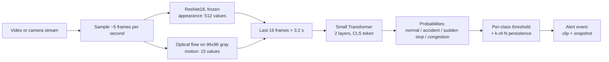
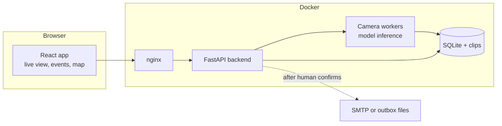

# Traffic Monitor: accident, sudden-stop and congestion detection

An end-to-end system that watches traffic video, classifies what it sees as **normal, accident, sudden stop or congestion**,
and lets a human operator review each alert (video clip, snapshot, map) before drafting emails to the nearest authorities.
Runs on a **CPU only** machine.

<!-- After pushing: save a screenshot as docs/dashboard.png, then delete this line and uncomment the next one.

-->
**Demo video:** _add a link here_

## What it does
- Classifies traffic video into 4 states with a **CNN (spatial) + Transformer (temporal)** model, plus optical-flow motion features.
- **Web app** (React): live camera tiles, review queue, evidence clip player with the alert moment marked, map, confirm / dismiss.
- **Alerts with safeguards:** nothing is sent until an operator confirms. Emails go to the nearest active police / hospital /
  traffic-control contact, can be edited first, and track acknowledgement (with escalation to the next-nearest authority).
- **Feedback loop:** confirmed events and dismissed false alarms export as new training data.
- **Docker:** one command starts the backend (FastAPI + model workers) and the frontend (nginx).

## How the model works

- **Why a frozen CNN:** with ~12-15 videos per class, training a CNN from scratch overfits. The CNN runs once per sampled frame;
  features are cached, so training the Transformer takes minutes on CPU.
- **Why optical flow:** one frame cannot tell dense-and-flowing from dense-and-stopped traffic. Motion can.
- **Why persistence rules:** an alert needs several consistent predictions in a row (4 of the last 6), so a single noisy window
  never raises an alert.
- **Alert thresholds** are chosen per class from validation precision, not guessed.

## System design


## Results (honest version)
| Test | Result |
|---|---|
| Holdout: 3 videos per class, never used in training, new sources | **11 / 12 videos correct** |

Reproduce with `python evaluate_folder.py --root holdout`. This is a small test (12 videos), so the true accuracy could plausibly
be anywhere from roughly 65% to 98%; treat it as evidence that the approach works, not as a benchmark.

## Limitations
- **Little data:** about 12-15 training videos per class; accident has the least because accident video is hard to find.
- **Whole-clip labels are noisy:** a clip labeled "sudden stop" may contain seconds of normal driving. Trimming clips to the event
  (see below) helps.
- **False alerts on long normal footage** have not been measured rigorously. An early test on dense, flowing highway video showed
  a few per ~7 minutes, before later improvements. The human confirmation step exists because of this.
- **Camera dependence:** trained on a handful of camera views; new cameras (night, rain, different angle) will be less accurate.
- **Never tested on a real live camera**, only on recorded clips and uploads. Live sources are supported (RTSP, webcam stream)
  but unproven.
- "Nearest authority" uses straight-line distance, not driving time. Use test email addresses; real contacts need agreements and
  verification that this project does not provide.

## Quick start (Docker)
Needs Docker Desktop. The trained model `temporal.pth` is included.
```
git clone <this repo>
cd <this repo>
copy .env.example .env           # Mac/Linux: cp .env.example .env
docker compose up --build
```
Open **http://localhost:8080** (API docs: http://localhost:8000/docs).

First tour:
1. **Authorities:** add test contacts (`@example.com` or your own address), or run
   `docker compose exec backend python backend/seed_demo.py --lat 28.6139 --lng 77.2090` (demo coordinates; use where your video was filmed).
2. **Cameras > Analyze an uploaded video:** pick a traffic video, click the map for its location, upload.
3. **Events:** open the new event, watch the clip, **Confirm**, edit the drafted emails, **Send**. Emails are dry-run by default
   (saved to the outbox, nothing leaves your machine).

Check which detector runs: http://localhost:8000/api/health shows `"mock_detector": false` for the real model.
`MOCK_DETECTOR=1` in `.env` gives scripted fake alerts for a UI-only demo.

## Run without Docker
```
pip install -r requirements.txt -r backend/requirements.txt
python -m uvicorn backend.app.main:app --port 8000
cd frontend && npm install && npm run dev        # http://localhost:5173
```

## Train on your own videos
Put videos in `videos/<class>/` (`normal`, `accident`, `sudden_stop`, `congestion`), then:
```
python make_labels.py          # adds new videos to labels.csv with an automatic train/val/test split
python extract_features.py     # one-time per video: CNN + motion features, cached; also makes augmented copies
python train.py                # trains, picks per-class thresholds, prints val/test results, saves temporal.pth
python evaluate_folder.py --root holdout     # honest test: videos in holdout/<class>/ never used in training
```
- **Trim clips to the event:** edit `labels.csv` rows (`video,split,start_s,end_s,label`). One video can have several rows
  (same split!), e.g. `sudden_stop` for 28-42 s and `normal` for the rest: free hard negatives from the same camera.
  `python peek_video.py <video> --every 5` helps find the timestamps.
- A video (or time range) belongs to **one split only**; the scripts refuse overlaps and duplicate files across class folders.
- Re-running only processes new or changed videos (cached by file and settings).
- Live sources (Cameras page): RTSP / HTTP stream URLs, or a webcam via `python tools/webcam_stream.py`.
  Inside Docker use `http://host.docker.internal:5001/video`.

## Configuration (`.env`)
| Variable | Meaning | Default |
|---|---|---|
| `MOCK_DETECTOR` | 1 = scripted fake alerts, 0 = real model | 0 |
| `SEND_MODE` | `dry_run` saves emails, `smtp` really sends | dry_run |
| `TEST_RECIPIENT` | if set, EVERY email goes to this one address | empty |
| `SMTP_HOST/PORT/USER/PASS`, `MAIL_FROM` | mail server for `smtp` mode | empty |
| `API_KEY` | require this key for the API (enter it in the app's settings) | empty (off) |
| `PUBLIC_BASE_URL` | address used for links inside emails | http://localhost:8080 |
| `MAX_RADIUS_KM`, `ACK_TIMEOUT_MIN`, `COOLDOWN_S` | authority search radius, escalation wait, duplicate-alert window | 50, 10, 90 |

Never commit `.env` (it is in `.gitignore`).

## Project structure
```
src/                 model, detector, motion features, augmentation, label helpers
make_labels.py  extract_features.py  train.py  evaluate_folder.py  detect.py  peek_video.py
labels.csv           which video/time range has which label
temporal.pth         trained Transformer weights (small)
backend/app/         FastAPI app: cameras, events, clips, alerts, authorities, training export
backend/tests/       backend smoke test (works without a trained model)
frontend/            React app (Vite) + nginx config
tools/               webcam_stream.py: publish a webcam as a stream for Docker
Dockerfile  docker-compose.yml  .env.example
videos/  holdout/    your data (not committed)
```

## Tech stack
PyTorch (CPU), torchvision ResNet18, OpenCV (optical flow, video I/O), FastAPI, SQLite, ffmpeg (browser-playable clips),
React + Vite, Leaflet + OpenStreetMap, Docker Compose, nginx.

## Roadmap
More accident data and cross-validation for steadier numbers; false-alert-per-hour measurement on long footage; webcam capture
straight from the browser; a normal-only anomaly score to catch unseen event types; hard-negative mining from operator dismissals.

## Data and licensing
Training videos are not included (size, and the sources have their own licenses). Check each source's license before
redistributing footage.